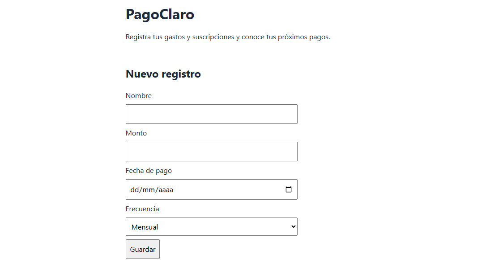

# PagoClaro

Aplicación web para registrar gastos y suscripciones y saber cuándo toca pagar cada uno.



## Descripción

PagoClaro ayuda a estudiantes y jóvenes que manejan varias suscripciones y servicios a no olvidar ninguna fecha de pago. El usuario registra cada pago una sola vez (nombre, monto, fecha y frecuencia) y la aplicación muestra los próximos pagos ordenados por fecha, con los días que faltan para cada uno.

## Qué hace el MVP

- Registra un pago con nombre, monto, fecha de pago y frecuencia (mensual o anual).
- Valida que el nombre y el monto no estén vacíos.
- Guarda los datos en el navegador con `localStorage`.
- Muestra la lista de próximos pagos ordenada de la fecha más cercana a la más lejana, con los días restantes.

## Qué no hace (alcance)

- No procesa pagos ni se conecta a cuentas bancarias.
- No tiene cuentas de usuario ni notificaciones por correo.
- Usa solo datos de prueba y no recolecta datos personales reales (Ley 1581 de 2012).

## Cómo ejecutarlo

1. Clona el repositorio:
   ```bash
   git clone https://github.com/AlejandroBohorquez001/Ubuntu.git
   cd Ubuntu
   ```
2. Abre `index.html` en el navegador. No necesita instalar nada.
   - Opcional, con servidor local: `python3 -m http.server 8000` y entra a `http://localhost:8000`.

## Tecnologías usadas

- HTML, CSS y JavaScript (sin frameworks)
- `localStorage` del navegador
- Git y GitHub para el control de versiones
- WSL (Ubuntu) como entorno de desarrollo
- OpenCode como asistente de programación con IA
- Fizzy para organizar el trabajo

## Estructura del proyecto

```
index.html
css/styles.css
js/app.js
README.md
AGENTS.md
```

## Uso de inteligencia artificial

El código fue generado con OpenCode (OpenCode, s.f.) a partir de instrucciones del autor. El texto de la documentación y los mockups se elaboraron con apoyo de Claude (Anthropic, 2026).

## Autor

Jose Alejandro Bohorquez Suarez, Ingeniería de Sistemas, UNICOC.

## Referencias

37signals. (s.f.). *Fizzy: A modern spin on kanban for tracking anything*. https://www.fizzy.do

Anthropic. (2026). *Claude* (versión Claude Sonnet 5.5) [Modelo de lenguaje de gran tamaño]. https://claude.ai

GitHub. (s.f.). *Quickstart for repositories*. GitHub Docs. https://docs.github.com/en/repositories/creating-and-managing-repositories/quickstart-for-repositories

Ley 1581 de 2012. Por la cual se dictan disposiciones generales para la protección de datos personales. 17 de octubre de 2012. D.O. No. 48.587.

Microsoft. (s.f.). *How to install Linux on Windows with WSL*. Microsoft Learn. https://learn.microsoft.com/en-us/windows/wsl/install

OpenCode. (s.f.). *OpenCode: The open source AI coding agent*. https://opencode.ai
